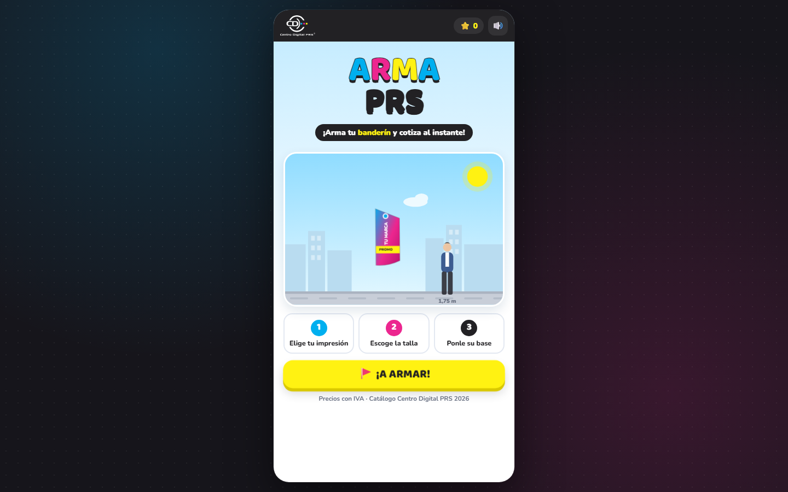

# Arma PRS · Custom banner configurator

A gamified configurator: customers build their custom pennant in 3 steps, get an instant quote and send the order by WhatsApp.

[🇪🇸 Leer en español](#-español)

  



## ✨ Highlights

- 3-step builder with live visual preview
- Instant price calculation
- Order summary sent straight to WhatsApp
- Single HTML file, no dependencies

## 🚀 Run locally

No build step. Open `index.html` in a browser, or serve the folder:

```bash
npx serve .
```

## 👤 Author

Designed and developed by **Sneyder Riaño**, graphic designer & web developer in Bogotá, Colombia.
[Portfolio](https://sneyder.netlify.app) · [GitHub](https://github.com/artsneyderdiseno-droid)

> Brand names, logos and photos belong to their respective owners and are shown with permission as portfolio work. The code is shared for review purposes; please don't reuse brand assets.

---

## 🇪🇸 Español

Un configurador tipo juego: el cliente arma su banderín en 3 pasos, recibe la cotización al instante y envía el pedido por WhatsApp.

**Lo más destacado**

- Armado en 3 pasos con vista previa en vivo
- Cálculo de precio al instante
- Resumen del pedido enviado directo a WhatsApp
- Un solo archivo HTML, sin dependencias

**Cómo ejecutarlo**

Sin compilación. Abre `index.html` en el navegador o sirve la carpeta con `npx serve .`

Diseño y desarrollo: **Sneyder Riaño** · Bogotá, Colombia.
